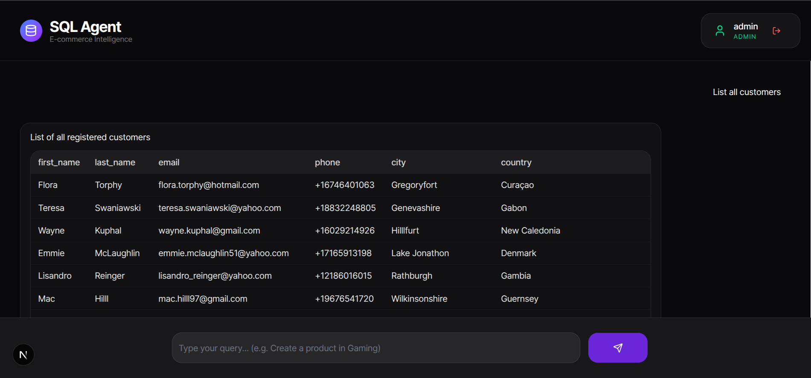

<div align="center">

# 🗄️ SQL Agent — E‑Commerce AI Assistant

**When was the last time you actually typed keywords into Google?**
Most people just open a chat window and say what they want. This project brings that experience to e‑commerce — instead of forcing users to click through 6 filters, the **website adapts to how people already think and talk**.

<p align="center">
  
</p>

</div>

---

## ✨ Why This Project

Traditional e‑commerce UIs force you to learn how a website works. This AI agent flips the model:

- **Customer types:** *"I need earbuds with great sound for daily use."*
- **Admin types:** *"Delete the Gaming category."*

No filters. No scrolling. The agent understands intent, queries the product database, and responds with the answer — rendered as a **table, chart, or plain text** depending on what fits.

---

## 🔐 The Harder Part: Role-Based Authorization

**Same chatbot. Same conversation window. Completely different permissions.**

Permissions are enforced at the **agent level** (in the tool-calling layer), not just hidden in the UI. The LLM itself is bound to the authenticated user's role on every single request.

| Capability | 🛍️ Customer | 👑 Admin |
| --- | :---: | :---: |
| Browse products, prices & categories | ✅ | ✅ |
| Run analytics (sales, stock, comparisons) | ✅ | ✅ |
| Insert / update / delete products | ❌ | ✅ |
| Modify categories or other DDL | ❌ | ✅ |

> An admin can literally type *"create a product in Gaming"* and it **just works** — securely. A customer trying the same thing gets an immediate `Unauthorized` response, even if the LLM generates a write query.

### Defense in Depth
1. **Prompt binding** — the system prompt injects the current user's role into every request.
2. **SQL sanitizer** (`src/lib/db.ts`) — strips multi-statement queries, blocks DML/DDL for customers, and auto-appends `LIMIT`.
3. **Server-side enforcement** (`executeWithRole`) — rejects any write operation when the resolved role isn't `admin`.
4. **JWT sessions** — `httpOnly`, `sameSite=lax` cookies with 7-day expiry (HS256 via `jose`).

---

## 🧠 How It Works

```
User message
   │
   ▼
/api/chat ───────────────► LangChain Agent (createAgent)
                                  │  system prompt = schema + current role
                                  │
                                  ▼
                          Tool: execute_sql
                                  │  role-aware SQL sanitizer
                                  ▼
                          SQLite (Ecommerce.db)
                                  │
                                  ▼
                  Structured JSON response { summary, uiType, columns, rows }
                                  │
                                  ▼
            Rendered as Text / Table / Bar / Line / Pie chart (Recharts)
```

- **Intent → SQL**: the agent translates natural language into SQLite queries and self-corrects up to 5 attempts.
- **UI inference**: a smart post-processor (`src/lib/infer-ui-type.ts`) upgrades plain responses into the best chart type — so a "top 5 products by sales" query becomes a bar chart automatically.
- **Bring your own model**: swap between **Groq** (fast, hosted) and **Ollama** (local, private) with one env var.

---

## 🚀 Quick Start

### Prerequisites
- [Bun](https://bun.sh) (or Node 20+)
- An LLM backend — either:
  - a [Groq](https://groq.com) API key, **or**
  - [Ollama](https://ollama.com) running locally

### 1. Install

```bash
bun install
```

### 2. Configure environment

```bash
cp .env.example .env   # create if missing
```

| Variable | Description | Default |
| --- | --- | --- |
| `USE_GROQ` | `"true"` → Groq, else Ollama | `false` |
| `GROQ_API_KEY` | Your Groq API key | – |
| `GROQ_MODEL` | e.g. `openai/gpt-oss-120b` | `openai/gpt-oss-120b` |
| `OLLAMA_MODEL` | Ollama model tag | `gemma4:cloud` |
| `OLLAMA_BASE_URL` | Local Ollama endpoint | `http://localhost:11434` |
| `JWT_SECRET` | Signing secret for sessions | dev fallback |

### 3. Seed the database

```bash
bun run seed
```

Creates `src/db/Ecommerce.db` with `users` and `products` tables plus demo data.

### 4. Run

```bash
bun run dev
```

Open [http://localhost:3000](http://localhost:3000).

### 🎭 Demo Logins

| Role | Email | Password |
| --- | --- | --- |
| 👑 Admin | `admin@example.com` | `admin123` |
| 🛍️ Customer | `customer@example.com` | `customer123` |

> **Try it:** log in as admin and type *"Create a new product in Gaming"*, then log out, log in as customer and type the same thing. Watch it refuse.

### 🖥️ CLI Mode (agent-only, no UI)

```bash
bun run agent
```

An interactive REPL that runs the same LangChain agent straight from your terminal.

---

## 🛠️ Tech Stack

| Layer | Technology |
| --- | --- |
| **Framework** | Next.js 16 (Turbopack), React 19 |
| **AI / Agents** | LangChain, LangGraph `createAgent`, tool-calling |
| **LLM Providers** | Groq (`@langchain/groq`) · Ollama (`@langchain/ollama`) |
| **Database** | SQLite (`sqlite3`, `better-sqlite3`) + seed script |
| **Auth** | JWT (jose) with `httpOnly` cookies |
| **UI** | Tailwind CSS v4, shadcn/ui, MobX state, Recharts |
| **Validation** | Zod (tool schemas + response contracts) |
| **Tooling** | TypeScript, Biome (lint/format), Bun |

---

## 📁 Project Structure

```
src/
├── action/            # CLI agent + standalone tool definitions
├── app/
│   ├── api/
│   │   ├── chat/      # POST /api/chat — main agent endpoint
│   │   └── auth/login/# POST /api/auth/login — session creation
│   └── page.tsx       # Chat UI (MobX observer)
├── components/        # Chat message view, charts, tables, login modal
├── db/                # Ecommerce.db + seed script
├── lib/
│   ├── agent.ts       # Role-aware LangChain agent builder
│   ├── db.ts          # SQL sanitizer + role-enforced executor
│   ├── auth.ts        # JWT sessions (sign / verify / read cookie)
│   └── infer-ui-type.ts # Chart-vs-table auto selection
└── store/             # MobX stores (auth modal)
```

---

## 🔒 Security Notes

- Write operations are **rejected server-side** for non-admin roles — never rely on prompt behavior alone.
- Queries are sanitized: single statement only, `SELECT` enforced for customers, auto-`LIMIT 20`.
- Sessions are signed JWTs stored in `httpOnly` + `sameSite=lax` cookies.
- The DB path is resolved at runtime with a clear error if `Ecommerce.db` is missing.
- `JWT_SECRET` has a dev fallback — **set a strong value in production**.

---

## 🧪 Verified Commands

```bash
bun run dev      # development server
bun run build    # production build (type-checked)
bun run lint     # biome check
bun run seed     # (re)create + seed the SQLite database
bun run agent    # headless CLI agent REPL
```

---

<div align="center">

**Built to answer the question: *What if the store simply understood what you meant?***

</div>
